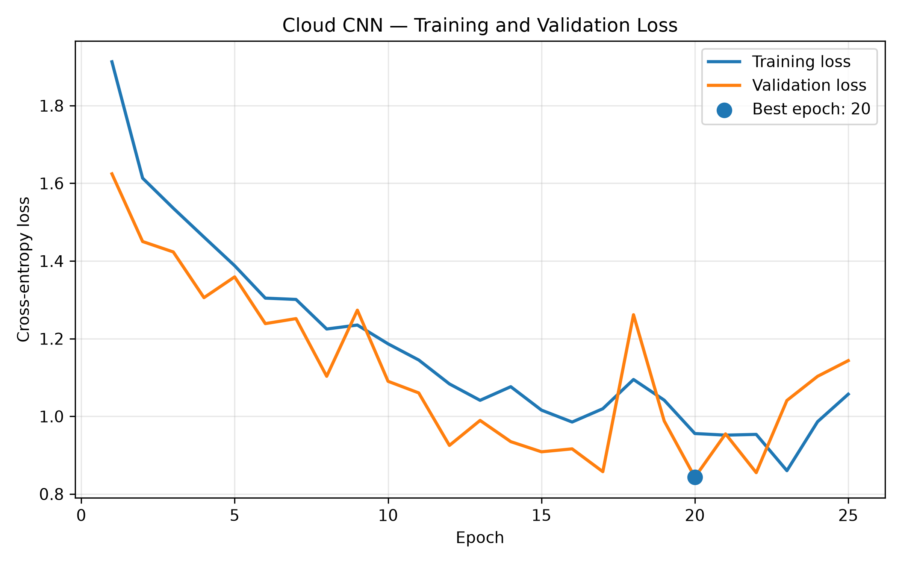
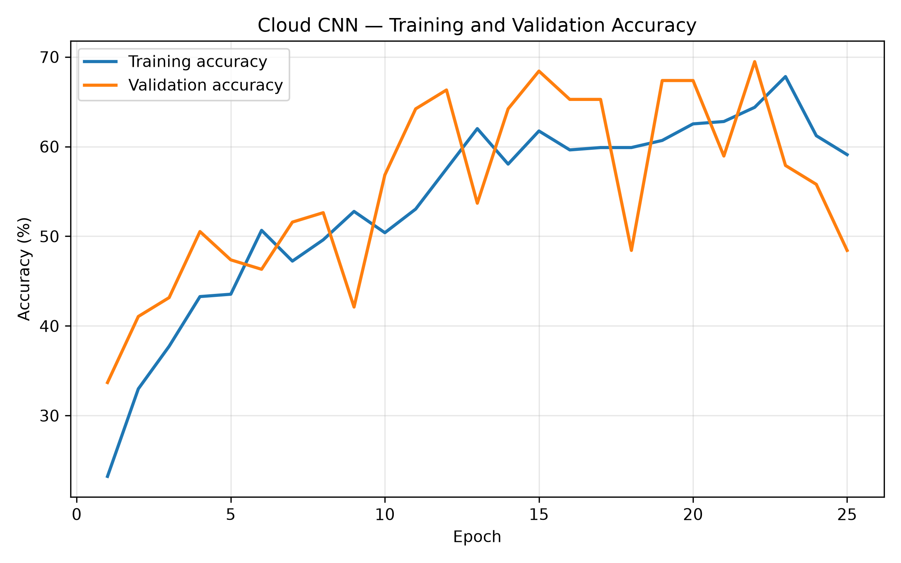
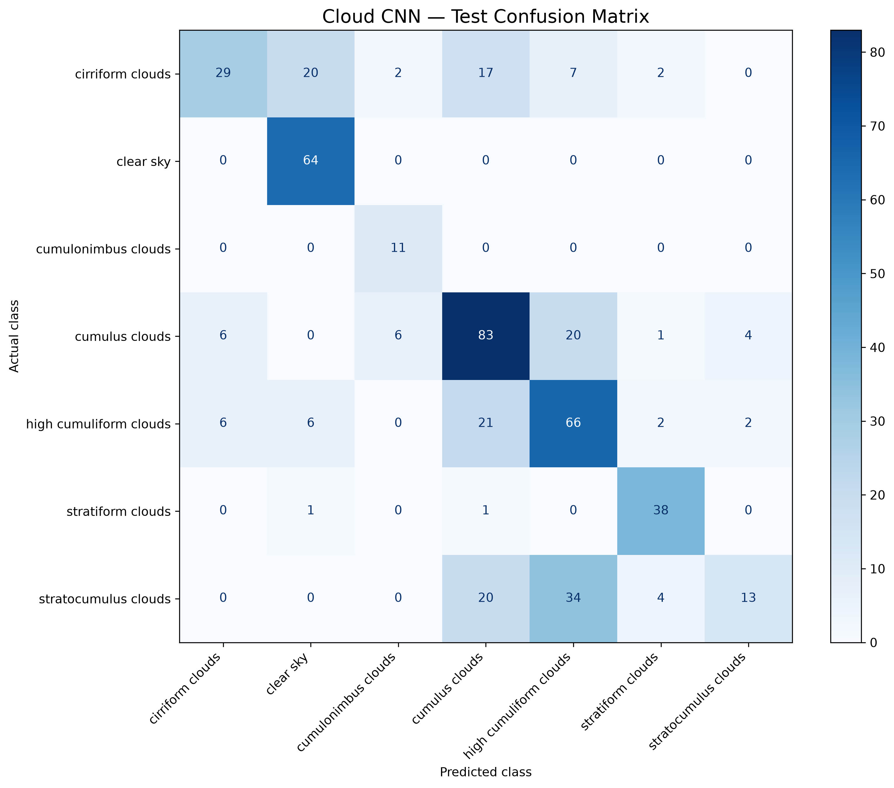
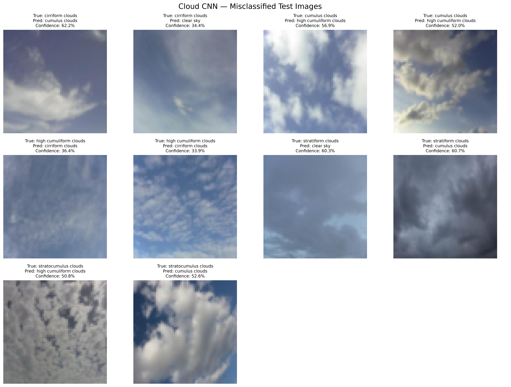

# Cloud Image Classification Using PyTorch CNN

A deep learning project implementing a Convolutional Neural Network (CNN) to classify sky images into seven cloud categories using PyTorch.

The project demonstrates an end-to-end image classification workflow, including image preprocessing, data augmentation, CNN architecture design, model training, hyperparameter experiments, evaluation and error analysis.

## 1. Project Overview

**Objective:** Develop and evaluate a CNN capable of distinguishing seven types of cloud and sky conditions.

**Technologies:** Python, PyTorch, TorchVision, NumPy, pandas, scikit-learn and Matplotlib.

The implementation uses CPU-based training and includes detailed code comments explaining tensor dimensions throughout the network.

## 2. Dataset

The dataset contains **960 images**, organised into seven classes:

- Cirriform clouds
- Clear sky
- Cumulonimbus clouds
- Cumulus clouds
- High cumuliform clouds
- Stratiform clouds
- Stratocumulus clouds

| Dataset | Images |
|---|---:|
| Training | 379 |
| Validation | 95 |
| Test | 486 |
| **Total** | **960** |

The training and validation sets are created using an 80/20 stratified split of the original 474 training images.

Class imbalance is present, particularly for cumulonimbus clouds, which have only 14 images in the original training dataset.

The dataset is excluded from version control.

## 3. Image Preprocessing

All images are resized to **64 × 64 pixels** and converted to PyTorch tensors.

Training transformations include random horizontal flipping, rotation and autocontrast.

Validation and test images undergo deterministic resizing and tensor conversion only.

**Tensor dimensions:**

- Individual image: `(3, 64, 64)`
- Batch of 16 images: `(16, 3, 64, 64)`
- Labels: `(16,)`

## 4. CNN Architecture

The model uses two convolutional blocks followed by a fully connected classification layer.

| Layer | Output Dimensions |
|---|---|
| Input | (B, 3, 64, 64) |
| Conv2d (3 → 32, 3×3, padding=1) | (B, 32, 64, 64) |
| ELU | (B, 32, 64, 64) |
| MaxPool2d (2×2) | (B, 32, 32, 32) |
| Conv2d (32 → 64, 3×3, padding=1) | (B, 64, 32, 32) |
| ELU | (B, 64, 32, 32) |
| MaxPool2d (2×2) | (B, 64, 16, 16) |
| Flatten | (B, 16384) |
| Linear (16384 → 7) | (B, 7) |

**Total trainable parameters:** 134,087.

The final layer produces seven raw logits, which are passed directly to cross-entropy loss during training.

## 5. Training Methodology

- Optimiser: Adam
- Loss function: CrossEntropyLoss
- Batch size: 16
- Maximum epochs: 30
- Early stopping patience: 5
- Model selection: Minimum validation loss
- Random seed: 42
- Device: CPU

The best model checkpoint is saved whenever validation loss improves.

Training and validation loss and accuracy are recorded for subsequent analysis.

## 6. Hyperparameter Experiments

Three learning rates were evaluated using the same stratified training/validation split.

| Learning Rate | Best Epoch | Best Validation Loss |
|---|---:|---:|
| 0.0003 | 12 | 1.0772 |
| **0.001** | **9** | **1.0514** |
| 0.003 | 11 | 1.1988 |

The learning rate of **0.001** achieved the lowest validation loss and was selected for the final stratified model.

These results represent individual training runs, not repeated cross-validation experiments.

## 7. Model Evaluation

The selected stratified CNN achieved the following results on the 486-image test set:

| Metric | Result |
|---|---:|
| Accuracy | 60.49% |
| Macro precision | 0.6377 |
| Macro recall | 0.6694 |
| Macro F1-score | 0.6249 |
| Weighted F1-score | 0.5918 |

Performance varied significantly across classes.

Clear sky and stratiform clouds achieved high recall, while stratocumulus and cirriform clouds proved more challenging.


### Baseline Training Curves

The following plots show the training behaviour of the
original CNN baseline using a random training/validation split.

**Training and validation loss**



**Training and validation accuracy**



### Baseline Confusion Matrix

The confusion matrix illustrates classification performance
and the main sources of confusion between cloud categories.




### Original baseline

An earlier experiment using a random training/validation split achieved:

- Test accuracy: 62.55%
- Macro F1-score: 0.6315

The original baseline test results were examined during development. Consequently, subsequent test evaluation should not be interpreted as a fully untouched final assessment.

## 8. Error Analysis

Confusion matrix analysis revealed substantial confusion between cumulus, high cumuliform and stratocumulus clouds.

Misclassified-image visualisation was used to investigate these errors and identify potential limitations associated with subtle cloud textures and low input resolution.

Further improvements could include transfer learning, higher-resolution images, alternative data augmentation strategies and techniques for handling class imbalance.


### Visualising Misclassified Images

The figure below shows examples of incorrectly classified
cloud images from the original baseline model.

Each image displays:
- The true cloud class
- The predicted cloud class
- The model's confidence in its prediction



The analysis highlights confusion between visually similar
cloud types, particularly cumulus, high cumuliform and
stratocumulus clouds.


## 9. Project Structure

```text
Cloud-Classification-PyTorch/
├── src/
│   ├── inspect_dataset.py
│   ├── data_loader.py
│   ├── visualise_data.py
│   ├── model.py
│   ├── train.py
│   ├── evaluate.py
│   ├── plot_training.py
│   ├── plot_confusion_matrix.py
│   └── visualise_predictions.py
├── experiments/
│   ├── baseline/
│   ├── stratified/
│   ├── higher_lr/
│   └── lower_lr/
├── results/
├── models/
├── notebooks/
├── data/                  # Excluded from Git
├── requirements.txt
├── .gitignore
└── README.md
```

Trained model checkpoints and the raw dataset are excluded from the repository.

## 10. Installation and Usage

Create a dedicated Python environment and install dependencies:

```bash
python -m pip install -r requirements.txt
```

Place the cloud dataset in the following directory structure:

```text
data/clouds/
├── clouds_train/
│   └── class folders...
└── clouds_test/
    └── class folders...
```

Inspect the dataset:

```bash
python src/inspect_dataset.py
```

Train the CNN:

```bash
python src/train.py
```

Evaluate a saved model:

```bash
python src/evaluate.py --experiment stratified
```

The evaluation command requires the corresponding trained checkpoint, which is not included in the repository.

## 11. Key Learning Outcomes

This project demonstrates practical understanding of CNN feature extraction, convolutional filters, spatial pooling, tensor dimensions, supervised training, early stopping, hyperparameter selection, classification metrics and model error analysis.

It also illustrates the limitations of training CNNs on relatively small, imbalanced image datasets.

## 12. Future Work

Potential extensions include:

- Transfer learning with a pretrained ResNet or EfficientNet.
- Improved image augmentation and input resolution.
- Class-weighted loss functions.
- More robust validation using repeated or cross-validation experiments.
- Model interpretability using Grad-CAM.

---

**Project context:** Developed as a practical PyTorch CNN refresher and portfolio demonstration, building upon DataCamp's *Deep Learning for Images with PyTorch* course.